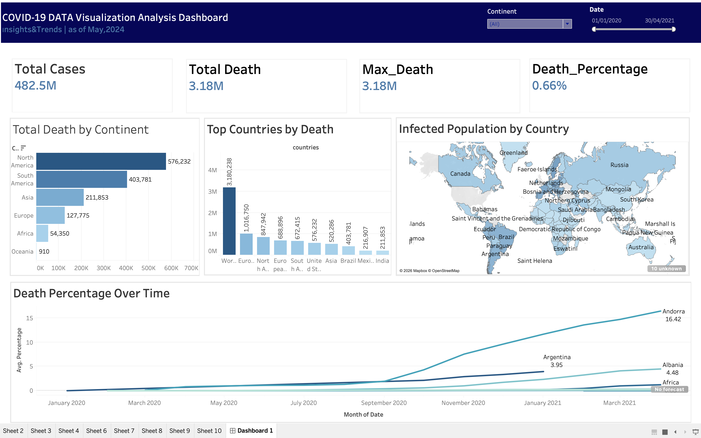

# COVID-19 Data Exploration

## Overview
This project explores COVID-19 data using SQL and Tableau to analyze deaths, vaccinations, and infection trends across countries.

## Tools Used
- SQL
- Tableau
- Excel
- GitHub

## Dataset
- CovidDeaths.xlsx
- CovidVaccinations.xlsx

## Key Analysis
- Total Cases vs Total Deaths
- Death Percentage by Country
- Infection Rate Compared to Population
- Vaccination Progress Over Time

## Dashboard

## Files
- Covid_Project.sql - SQL queries for data exploration
- Visualization COVID-19.twb - Tableau Dashboard
